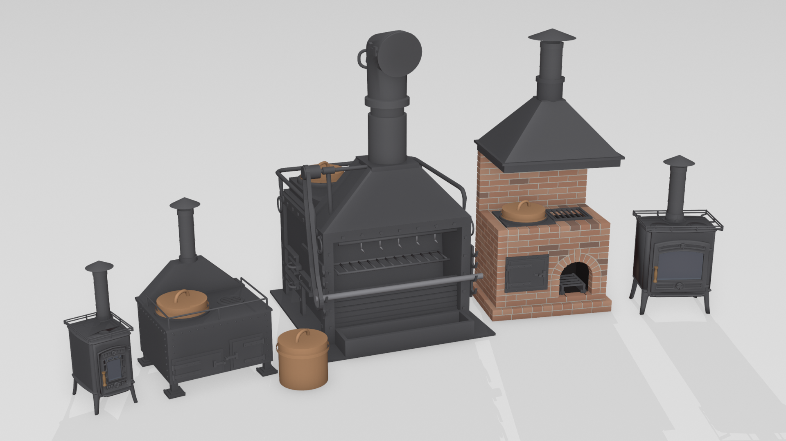

# Better Stoves 1.0.20

**Download:** see the [latest release](https://github.com/Dixiecapt/Better-Stoves/releases/latest): `BetterStoves-1.0.20.zip` to put in by hand (the `BetterStoves` folder goes into `BepInEx\plugins`), `BetterStoves-1.0.20-thunderstore.zip` for r2modman / Thunderstore. The illustrated catalogue is inside the Thunderstore zip, and on the release page as a PDF.

**Made by Dixiecapt with M.I.D.N.** M.I.D.N shares the credit for the
heavy-duty playtesting behind this version: five full playtests.

Five new stoves for Sailwind, in one mod. Two are the stoves merchant ships
really carried in the age of sail: the **Brick Galley** of about 1750 and
the sheet-iron **Camboose** of the 1780s. Two are for looks and comfort:
the **Tiny Ship Stove** for small boats and the **Cabin Stove** with its
fireplace door. And the **Brodie Galley Range** is the man-of-war's. All are
NEW items with their own save numbers; none of the game's stoves is
changed. They burn their wood slowly in a closed firebox, so a load lasts
the night, and each has a chimney you set in F1. No stove is barred from
any ship: its weight and its size are the only limit, as the game has it.

**Works with Vittles.** Vittles, the new cooking mod, needs Better Stoves
1.0.20. With Vittles, the ovens of the Camboose and the Brick Galley and the
Brodie's gridiron bake. Vittles brings its own skillet, wok, baking sheet
and bowls, and takes over soup in a mug. Better Stoves needs nothing of
Vittles to work.

| Stove | Where | Price |
|---|---|---|
| Tiny Ship Stove | Fort Aestrin, Dragon Cliffs | 2600 |
| Cabin Stove | Gold Rock | 2000 |
| Camboose | Gold Rock, Dragon Cliffs | 4000 |
| Brick Galley | Fort Aestrin, Dragon Cliffs | 5000 |
| Brodie Galley Range | Fort Aestrin | 7500 |
| Copper boiler | beside the stoves that have a well | 600 |

Prices are before the port's own rate. The Tiny and Cabin stoves cost what
the game's Aestrin and Al'Ankh stoves cost. Every stove keeps the shop hours
of the game's own stoves beside it.

An illustrated catalogue comes with the mod, redrawn for 1.0.20: open
**Better_Stoves_Catalogue.pdf** (or the .html in any web browser) for
pictures of every stove, its figures, and how each one is used.

**If you had Tiny Stove, Galley Range or Cabin Stove as separate mods,
remove them first.** Better Stoves holds the same stoves under the same save
numbers, so your stoves aboard carry straight over; but each number can be
held by one plugin only, and a leftover copy will refuse to load its stove.

---

## The Tiny Ship Stove

A small cast iron stove for a small boat: a flat top for one pot, a glass
door with the fire behind it, smooth sides between round corner posts, a
turned wooden grip, a pot rail round the top and a capped chimney.

- **Buy it** at Fort Aestrin, beside the stock Aestrin stoves, or at Dragon
  Cliffs - one on each side of the world. 2600.
- **Wood:** click it with split logs; it holds three. They burn one at a
  time, so a full load lasts **8 game hours** - the night.
- **Cooking:** one pot, kettle or skillet on the top, with the Aestrin
  stove's heat. The game's big pot is too big for its rail and is refused.
- **Chimney:** *Tiny Stove > Chimney length (m)* in F1, 0.2 to 8 m, changes
  while you play.
- **Pot rail:** *Tiny Stove > Pot rail* in F1. On for a stove at sea, off
  for one in a house ashore; changes at once.
- **Glass:** *Tiny Stove > Glass pane* in F1: crinkled (the game's own clear
  crinkled window glass, the default), clear, game (the game's glass as it
  is) or none.
- 0.44 m wide, 0.71 m to the top. Mass 50. Save number 32701.

## The Cabin Stove

A medium log-cabin stove: two eyes on the flat top, a glass door with a
fireplace behind it - logs on a basket grate over a bed of glowing coals -
a turned wooden handle, legs, and a capped chimney. It throws a warm,
flickering firelight about the cabin at night, and its smoke leans with the
wind.

- **Buy it** at Gold Rock in Al'Ankh, beside the stock Al'Ankh stoves. 2000.
- **Wood:** holds **six** logs (*Cabin Stove > Firewood it holds*, 3 to 9),
  burnt one at a time; a full load lasts **12 game hours** - a night and a
  day. The logs stack naturally on the grate; you see them burn through the
  glass.
- **Cooking:** two eyes; a pot, kettle or skillet on each, with the Al'Ankh
  stove's heat. The big pot is too big for the rail and is refused.
- **Size:** *Cabin Stove > Stove size* in F1 - 1 is 0.75 m wide and 0.93 m
  to the top; 0.8 is 0.60 m wide. Read when the game starts.
- **Chimney:** *Cabin Stove > Chimney length (m)* in F1, 0.2 to 8 m, changes
  while you play.
- **Pot rail:** a rail round both eyes. *Cabin Stove > Pot rail* in F1
  switches it on or off at once.
- **Glass:** *Cabin Stove > Glass pane*, the same four choices as the Tiny
  Stove; crinkled by default.
- Mass 80. Save number 32704.

## The Brick Galley (c. 1750)

What most merchant ships cooked on before the iron stoves: a brick block
built forward on a proud base course, a big copper set down into the top, an
iron grate beside it over an open arched hearth with a firedog in it, an
iron oven door on the left, and a broad sheet-iron hood tapering into the
chimney. You see the fire in the hearth and its coals glow; the whole block
throws firelight at night.

- **Buy it** at Fort Aestrin or Dragon Cliffs, beside the stock stoves. 5000.
  Mass 600 - a brick block.
- **Wood:** twelve logs, one at a time, **24 game hours** a load.
- **The well** (left of the top) takes the copper boiler, set down into the
  brickwork. **The grate** (right) takes a pot, the big pot, a kettle or a
  skillet - or a piece of food to grill, lying lengthwise along the bars,
  centred over the fire. Food you click on the galley always goes to the
  grate. The open arch is the fire.
- **The oven** (behind the iron door, left of the front) is for baking,
  which the Vittles mod brings. See *The ovens* below.
- *Brick back splash*, *Brick side splashes* and *Soot on the bricks* in F1
  dress the block.
- **Chimney:** *Brick Galley > Chimney length (m)*, 0.2 to 8 m.
- Save number 32706.

## The Camboose (c. 1780)

The compact sheet-iron merchant stove, after the one raised from the
General Carleton (built 1777, lost 1785): a riveted iron box on short legs
bolted down at the feet, a strap-hinged fire door and oven door on the front,
the copper's well and a grilled eye on top inside a pot-restraint rail, and
a flared smoke trunk carrying the pipe and its weather cap. The stove small
ships kept even after the Brodie came in.

- **Buy it** at Gold Rock or Dragon Cliffs, beside the stock stoves. 4000.
  Mass 150. 0.98 m wide, so the boiler and a big pot stand side by side.
  At the shop it stands on all four feet, even on sloping ground.
- **Wood:** six logs, one at a time, **12 game hours** a load.
- **The well** (left) takes the copper boiler, which sits well down into it;
  **the grilled eye** (right) a pot, the big pot, a kettle, a skillet or a
  piece of food to grill - food you click on the camboose always goes there;
  **the right-hand door** is the fire, under the grill; **the left-hand
  door** is the oven, under the copper, for baking with Vittles (see *The
  ovens* below).
- **Chimney:** *Camboose > Chimney length (m)*, 0.2 to 8 m.
- Smoking is the Brodie range's alone: neither the camboose nor the brick
  galley smokes.
- Save number 32705.

## The ovens (Camboose and Brick Galley)

- **Click the oven door** to swing it open or shut. Every door is shut when
  a game is loaded.
- **With the door open**, click a pan into the oven to put it in; use the
  open oven with an empty hand to take it out. A click on the stove top
  never sends anything into the oven.
- **The ovens bake only with the door shut**, and only with Vittles: without
  it they take nothing.
- With the door shut and something in the oven, an empty hand on the stove
  picks up nothing and tells you to open the door. With the oven empty, an
  empty hand picks up the stove as usual.
- Look at the door to see what is in the oven; with Cooked Info or Vittles
  it also shows how far along it is.

## The Brodie Galley Range

A man-of-war's galley stove of the 1780s: a riveted iron range with two
copper boilers set down into iron well frames at the back of the top, two
stove eyes in front of them, an open hearth at the front with a bed of coals,
a turning spit and a gridiron, five smoking hooks under the hood, and a flue
with a cowl on top. It is the king of cookers: it boils, grills, roasts and
smokes, and with Vittles it bakes too. No ship is barred from it: it weighs
400 kg and stands nearly two metres, and that is the only limit - put one on
a small boat and carry less cargo.

- **Buy it** at Fort Aestrin, beside the stock Aestrin stoves: the range is
  7500, a copper boiler 600; two boilers stand for sale with it.
- **Nail it down** with a hammer - a 400 kg range on a rolling deck wants
  to be. Nailed, it holds its place on the ship through storms, reloads and
  leaving the ship.
- **Wood:** holds twelve logs (F1), burnt one at a time; the pots get a
  full stock stove's heat, and more wood only burns longer. Twelve is a day
  and a night. The coals in the hearth glow while it burns and go grey when
  the fire is out.

### Cooking on the range

| Place | Takes | Does |
|---|---|---|
| **Two boiler wells** (back of the top) | copper boilers only | boils soup; a boiler holds 30 units (half a barrel) |
| **Two eyes** (front of the top) | the game's pot and kettle, a skillet | cooks with the Aestrin stove's heat; pots sit on the iron |
| **The spit** (in the hearth) | three pieces of food | roasts; turns while the fire burns (*Spit turns* in F1) |
| **The gridiron** (over the coals) | one piece of food, a skillet or a baking sheet | grills or fries; with Vittles it bakes |
| **Five hooks** (under the hood) | one piece of food each | smokes, slowly and gently, like the game's smoking racks - five fish at once |

- **Pots, kettles and boilers:** click the range with one and it goes to a
  free eye or well of its kind.
- **Food:** hold it and look at the spit, the gridiron or a hook - the part
  lights up white - then click, and the food goes onto that part. Click
  anywhere else on the range with food and it asks *Where on the Brodie?*
- **The big pot** is too big for the eyes and is refused: the boilers do
  its work.
- A Vittles skillet on one of the range's eyes turns its handle out to the
  side, away from the middle of the range; on every other stove the handle
  points toward you.

### The copper boilers

A boiler is a big copper pot that sits DOWN in its well - the lip rests on
the well frame, the lid stands above. Lift it out like any pot. Fill it with
water from a barrel, put food in, and it cooks in the well. It holds 30
units (F1, *Boiler capacity (units of water)*); the game's pot holds 10, the
big pot 20. It cannot be tipped over to drink from like the game's pots;
you serve from it: click it holding one of the game's pots and that pot
fills from the boiler, soup and all. With **Hooks Hang More**, an empty
boiler hangs on a wall hook by its lid handle.

The Camboose and the Brick Galley each have one well for a boiler too.
Boilers are sold beside the stoves: two beside the Brodie range, one beside
a camboose or a brick galley (one per port, never more than two in a port),
none where no stove has a well.

### Soup in a mug

Click any mug or bottle on any pot of soup - a boiler, the game's pot, the
big pot - and it fills with **hot soup**. It steams; drink it and it feeds
you as the soup would. It keeps hot four times as long as soup in a pot off
the fire; once it cools it starts to go off, and in about a game day it is
rotten - the look text says hot, cold or rotten. A rotten pot fills no mug.
A bottle of soup poured into another bottle carries its state with it.
**With Vittles installed, Vittles does all of this instead**, the same way;
Better Stoves then leaves mugs alone.

### The flue

- *Galley Range > Chimney length (m)* in F1 sets how tall the flue stands
  above the hood, 0.3 to 8 m, while you play - run it up through the deck.
- *Cowl facing (degrees)* turns the bend at the top: 0 points it toward the
  front of the range (the hearth), 90 to the right, 180 behind, 270 to the
  left. Aim it at the stern however the range stands. *Cowl turns from the
  wind* instead swings it away from the wind, as the real one was turned by
  hand.
- Mass 400. Save numbers 32702 (range) and 32703 (boiler).

---

## Fixes to the game's own stoves and soup

- Pouring out or drinking from a pot of rotten soup used to make what was
  left fresh again (a bug in the game). Now what is left stays as rotten as
  it was, in every pot, kettle and boiler.
- A stove no longer gives a burst of flame, smoke and sizzle while the game
  loads: every stove, the game's own too, starts dark and silent until it
  is lit.
- A loose stove set down ashore stays where it is set (a big stove set
  against a wall could be thrown through it).

## Shops

Each stove stands for sale beside the port's stock stoves, at a spot set by
hand at every port it is sold in. If the spot lands badly at your port, or
you want a stove sold somewhere else, stand where it should be, facing the
way its front should face, and switch on that stove's *Mark the spot where I
stand* - the spot moves there at once and is remembered. The Tiny Stove, the
Camboose and the Brick Galley keep one mark for each port, in any port with
a shop, listed under *Marked spots*; *Remove the marked spot at this port*
takes one away. The Cabin Stove has one mark, made near its stove seller.
The range has one for itself and one for its boilers, made at the Fort:
*Mark the range spot where I stand* and *Mark the boiler spot where I
stand*. The Camboose
and Brick Galley set their boilers to either side with *Boilers beside it on
the*.

## F1 settings

All of it is under **Better Stoves** in F1, in six groups: Look, Tiny Stove,
Cabin Stove, Camboose, Brick Galley, Galley Range.

- **Look > Texture look** - how the stoves are painted, all at once:
  *Detailed* (the default, every picture as made), *Plain* (softer: half
  size, lightly blurred, less contrast) or *Stock Sailwind* (each part takes
  the game's own closest picture or paint - the bricks may become the game's
  red cobbles or stone; close enough). The coals, ash and soot keep their
  own look, and the glass is set by *Glass pane*. It changes as you set it.
- **Each stove's group** has its chimney length, its wood (*Hours a full
  load burns*, *Logs burning at once*, and *Firewood it holds* on all but the
  Tiny Stove, which always takes three) and its shop settings.
- **Prices:** *Camboose > Price*, *Brick Galley > Price*, *Galley Range >
  Range price* and *Boiler price*. The Tiny and Cabin stoves have no price
  setting: they cost what the game's stove beside them costs.
- *Report each stove shape* (Tiny Stove and Cabin Stove) writes a few lines
  to the log when a stove appears, for bug reports. It is off, and shown
  only when **Show advanced** is ticked at the top of F1.

Every stove burns its wood one log at a time so a load lasts, yet gives its
pots the full heat of the game's own stove of its country (the Aestrin
stove's three logs' worth, the Al'Ankh stove's for the Cabin Stove).
*Logs burning at once* only sets how fast the wood goes.

### One stove at a time

The looks are set stove by stove: the chimney on every stove, the pot rail
and glass pane on the Tiny and Cabin stoves, the splashes and soot on the
Brick Galley, and the cowl on the Galley Range.

- Stand within 2 m of a stove you own and change one in F1: only that stove
  changes, and it keeps the setting in your save. A stove in your house and
  one on your ship can each have their own chimney.
- Walking up to another stove changes nothing on it.
- Change one anywhere else and it sets the default: stoves for sale use it,
  and so does every stove you have never set by hand.
- Open F1 beside a stove and it shows that stove's own settings.

## Works with

**Vittles** (needs Better Stoves 1.0.20), Cooked Info (its cooking
percentage shows on the oven door), Hooks Hang More, Better Tables (any
version), Better Lanterns and Lights, Furniture Fix, Deft Hands, Dizzy's
Firewood Bundle, Economy Overhaul, Kemy's furniture and navigation tools,
Dangerous Waters. Every collider and every other mod's behaviour hung on a
stock stove is stripped from the copies, so nothing clips, jiggles or fights
the firelight; and each stove keeps its own number in the game's prefab list
even when another mod hands the game a fresh list.

## Updating from 1.0.0

- **Your stoves and boilers carry over.** The save numbers are unchanged
  (32701 to 32706), and looks you set on one stove stay with it.
- **Your settings carry over.** No setting was renamed or removed.
- The Tiny and Cabin stoves' *Glass pane*, if your config still had the old
  *clear*, is moved to *crinkled* once at the first start. Set it back if you
  like; it then stays. A stove set by hand keeps its own glass.
- *Report each stove shape* was on in 1.0.0, and your config keeps it on.
  Switch it off (tick **Show advanced** in F1 to see it) unless you are
  sending a bug report.
- The Cabin Stove's and the Galley Range's marked-spot numbers are no
  longer shown in F1. They are still kept, and the mark switches still set
  them.
- Chimneys now go up to 8 m on every stove.
- The Camboose and the Brick Galley were remodelled with ovens behind doors
  that open; the Camboose stands on shorter legs, its top where it was.
  Stoves you already own take the new look.

## Bugs

Post in the Better Stoves thread on Discord, or message **Dixiecapt** on
Discord. Please include your log file,
`BepInEx\LogOutput.log` (in a mod manager: Settings > Browse profile folder,
then the BepInEx folder), and say what you did just before it went wrong.

## Removing the mod

A save holding one of these stoves needs this mod to load. Sell or drop
every stove and boiler first, save, then remove the mod. If only a model
file (`tinystove`, `galleyrange`, `cabinstove`, `hearthstoves`) goes
missing, that stove comes back as the stock stove it is built on so the save
still loads; put the file back and it is itself again.

## Credits

- **M.I.D.N** - shared credit with Dixiecapt for the heavy-duty
  playtesting: five full playtests.
- Tiny stove and cabin stove models by **olegiliushov**, who sent the
  second after seeing the first (open use licence). Cut, glazed, smoothed
  and fitted for the game.
- Brodie galley range model by **Uhlan**, CC BY-NC 4.0, fitted with wells,
  eyes, spit, gridiron, hooks, coals and cowl.
- Brick galley and camboose built from Dixiecapt's own research plates: the
  General Carleton camboose (Parks Canada) and period galley descriptions.
- Cooking, fire, smoke and sound: the game's own Aestrin and Al'Ankh stoves
  and big pot.
- Testing: Mad, Exocet and the Sailwind modding community.

The code is under the MIT licence (see LICENSE). The models keep their own
licences (see THIRD_PARTY.md).

## Version history

The full list is in CHANGELOG.md. Since 1.0.0, in short:

- the Camboose and Brick Galley ovens have doors that open, and bake with
  Vittles only with the door shut; the oven door shows how far along the
  baking is;
- F1 *Look > Texture look*: Detailed, Plain or Stock Sailwind;
- crinkled glass on the Tiny and Cabin stoves, now the default;
- chimneys up to 8 m on every stove;
- a loose stove ashore stays where it is set; stoves start dark and silent
  while the game loads;
- soup in a mug cools and spoils at the right pace, and steps aside for
  Vittles when Vittles is installed;
- faster: the stoves only look at the shops when an island loads, and do
  much less every frame.
