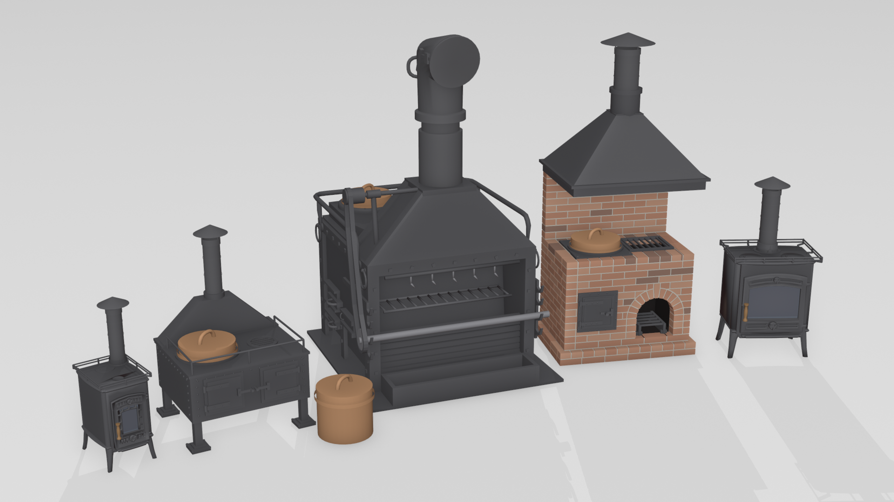

# Better Stoves 1.0.0

**Download:** see [Releases](https://github.com/Dixiecapt/Better-Stoves/releases/latest) - `BetterStoves-1.0.0.zip` to put in by hand (the BetterStoves folder goes into BepInEx\plugins), `BetterStoves-1.0.0-thunderstore.zip` for r2modman / Thunderstore. The catalogue of every stove comes inside both, and as a PDF on its own.

Five new stoves for Sailwind, in one mod. Two are the stoves merchant ships
really carried in the age of sail: the **Brick Galley** of the early 1700s
and the sheet-iron **Camboose** of the 1780s. Two are for looks and comfort:
the **Tiny Ship Stove** for small boats and the **Cabin Stove** with its
fireplace door. And the **Brodie Galley Range** is the man-of-war's. All are
NEW items with their own save numbers; none of the game's stoves is
changed. They burn their wood slowly in a closed firebox, so a load lasts
the night, and each has a chimney you set in F1. No stove is barred from
any ship: its weight and its size are the only limit, as the game has it.

| Stove | Where | Price |
|---|---|---|
| Tiny Ship Stove | Fort Aestrin, Dragon Cliffs | 2600 |
| Cabin Stove | Gold Rock | 2000 |
| Camboose | Gold Rock, Dragon Cliffs | 4000 |
| Brick Galley | Fort Aestrin, Dragon Cliffs | 5000 |
| Brodie Galley Range | Fort Aestrin | 7500 |
| Copper boiler | beside the stoves that have a well | 600 |

Prices are before the port's own rate. Every stove is sold by day only, like
the game's own stoves.

A catalogue comes with the mod: open **Better_Stoves_Catalogue.html** in any
web browser for pictures of every stove and how each one is used.

**If you had Tiny Stove, Galley Range or Cabin Stove as separate mods,
remove them first.** Better Stoves holds the same stoves under the same save
numbers, so your stoves aboard carry straight over; but each number can be
held by one plugin only, and a leftover copy will refuse to load its stove.

---

## The Tiny Ship Stove

A small cast iron stove for a small boat: a flat top for one pot, a glass
door with the fire behind it, smooth sides between round corner posts, a
turned wooden grip, a pot rail round the top and a capped chimney.

- **Buy it** at Fort Aestrin, beside the stock Aestrin stoves, or at Dragon
  Cliffs - one on each side of the world. 2600.
- **Wood:** click it with split logs; it holds three. They burn one at a
  time, so a full load lasts **8 game hours** - the night.
- **Cooking:** one pot, kettle or skillet on the top, with the Aestrin
  stove's heat. The game's big pot is too big for its rail and is refused.
- **Chimney:** *Tiny Stove > Chimney length* in F1, 0.2 to 2.5 m, changes
  while you play.
- **Pot rail:** *Tiny Stove > Pot rail* in F1. On for a stove at sea, off
  for one in a house ashore; changes at once.
- 0.44 m wide, 0.71 m to the top. Mass 50. Save number 32701.

## The Cabin Stove

A medium log-cabin stove: two eyes on the flat top, a glass door with a
fireplace behind it - logs on a basket grate over a bed of glowing coals -
a turned wooden handle, legs, and a capped chimney. It throws a warm,
flickering firelight about the cabin at night, and its smoke leans with the
wind.

- **Buy it** at Gold Rock in Al'Ankh, beside the stock Al'Ankh stoves. 2000.
- **Wood:** holds **six** logs, burnt one at a time; a full load lasts
  **12 game hours** - a night and a day. The logs stack naturally on the
  grate; you see them burn through the glass.
- **Cooking:** two eyes; a pot, kettle or skillet on each, with the Al'Ankh
  stove's heat. The big pot is too big for the rail and is refused.
- **Size:** *Cabin Stove > Stove size* in F1 - 1 is 0.75 m wide and 0.93 m
  to the top; 0.8 is 0.60 m wide. Read when the game starts.
- **Chimney:** *Cabin Stove > Chimney length* in F1, 0.2 to 3 m, changes
  while you play.
- **Pot rail:** a rail round both eyes. *Cabin Stove > Pot rail* in F1
  switches it on or off at once.
- Mass 80. Save number 32704.

## The Brick Galley (c. 1750)

What most merchant ships cooked on before the iron stoves: a brick block
built forward on a proud base course, a big copper set down into the top, an
iron grate beside it over an open arched hearth with a firedog in it, an
iron door to the oven on the left, and a broad sheet-iron hood tapering into
the chimney. You see the fire in the hearth and its coals glow; the whole
block throws firelight at night.

- **Buy it** at Fort Aestrin or Dragon Cliffs, beside the stock stoves. 5000.
  Mass 600 - a brick block.
- **Wood:** twelve logs, one at a time, **24 game hours** a load.
- **The well** (left of the top) takes the copper boiler, set down into the
  brickwork. **The grate** (right) takes a pot, the big pot, a kettle or a
  skillet - or a piece of food to grill, lying lengthwise along the bars,
  centred over the fire. Food you use on the galley always goes to the
  grate. The open arch is the fire.
- **The oven door** (left of the front) is for baking, which the Vittles mod
  brings. Use the galley with an empty hand to take out what is in the oven;
  with the oven empty, that picks up the galley.
- *Brick back splash*, *Brick side splashes* and *Soot on the bricks* in F1
  dress the block.
- Save number 32706.

## The Camboose (c. 1780)

The compact sheet-iron merchant stove, after the one raised from the
General Carleton (built 1777, lost 1785): a riveted iron box on short legs
bolted down at the feet, a strap-hinged fire door and oven door on the front,
the copper's well and a grilled eye on top inside a pot-restraint rail, and
a flared smoke trunk carrying the pipe and its weather cap. The stove small
ships kept even after the Brodie came in.

- **Buy it** at Gold Rock or Dragon Cliffs, beside the stock stoves. 4000.
  Mass 150. 0.98 m wide, so the boiler and a big pot stand side by side.
  At the shop it stands level on all four feet.
- **Wood:** six logs, one at a time, **12 game hours** a load.
- **The well** (left) takes the copper boiler, which sits well down into it;
  **the grilled eye** (right) a pot, the big pot, a kettle, a skillet or a
  piece of food to grill - food you use on the camboose always goes there;
  **the right-hand door** is the fire, under the grill; **the left-hand
  door** is the oven, for baking with Vittles (taken out as on the Brick
  Galley).
- Smoking is the Brodie range's alone: neither the camboose nor the brick
  galley smokes.
- Save number 32705.

## The Brodie Galley Range

A man-of-war's galley stove of the 1780s: a riveted iron range with two
copper boilers set down into iron well frames at the back of the top, two
stove eyes in front of them, an open hearth at the front with a bed of coals,
a turning spit and a gridiron, five smoking hooks under the hood, and a flue
with a cowl on top. It is the king of cookers: it boils, grills, roasts and
smokes, and with Vittles it bakes too. No ship is barred from it: it weighs
400 kg and stands nearly two metres, and that is the only limit - put one on
a small boat and carry less cargo.

- **Buy it** at Fort Aestrin, beside the stock Aestrin stoves: the range is
  7500, a copper boiler 600; two boilers stand for sale with it.
- **Nail it down** with a hammer - a 400 kg range on a rolling deck wants
  to be. Nailed, it holds its place on the ship through storms, reloads and
  leaving the ship.
- **Wood:** holds twelve logs (F1), burnt one at a time; the pots get a
  full stock stove's heat, and more wood only burns longer. Twelve is a day
  and a night. The coals in the hearth glow while it burns and go grey when
  the fire is out.

### Cooking on the range

| Place | Takes | Does |
|---|---|---|
| **Two boiler wells** (back of the top) | copper boilers only | boils soup; a boiler holds 30 units (half a barrel) |
| **Two eyes** (front of the top) | the game's pot and kettle, a skillet | cooks with the Aestrin stove's heat; pots sit on the iron |
| **The spit** (in the hearth) | three pieces of food | roasts; turns while the fire burns |
| **The gridiron** (over the coals) | one piece of food, or a skillet | grills or fries |
| **Five hooks** (under the hood) | one piece of food each | smokes, slowly and gently, like the game's smoking racks - five fish at once |

- **Pots, kettles and boilers:** click the range with one and it goes to a
  free eye or well of its kind.
- **Food:** hold it and look at the spit, the gridiron or a hook - the part
  lights up white - then click, and the food goes onto that part. Click
  anywhere else on the range with food and it asks *Where on the Brodie?*
- **The big pot** is too big for the eyes and is refused: the boilers do
  its work.
- A skillet (it comes with Vittles) on one of the range's eyes turns its
  handle out to the side, away from the middle of the range; on every other
  stove the handle points toward you.

### The copper boilers

A boiler is a big copper pot that sits DOWN in its well - the lip rests on
the well frame, the lid stands above. Lift it out like any pot. Fill it with
water from a barrel, put food in, and it cooks in the well. It holds 30
units (F1, *Boiler capacity*); the game's pot holds 10, the big pot 20. It
cannot be tipped over to drink from like the game's pots; you serve from
it. With **Hooks Hang More**, an empty boiler hangs on a wall hook by its
lid handle.

The Camboose and the Brick Galley each have one well for a boiler too.
Boilers are sold beside the stoves: two beside the Brodie range, one beside
a camboose or a brick galley (one per port), none where no stove has a well.

### Soup in a mug

Click any mug or bottle on any pot of soup - a boiler, the game's pot, the
big pot - and it fills with **hot soup**. It steams; drink it and it feeds
you as the soup would. Left standing it cools in about ten game minutes,
and after three game hours it has gone bad - the look text tells you which.
A bottle of soup poured into another bottle carries its state with it.
(This will move into Vittles, the cooking mod, when it comes out.)

### The flue

- *Galley Range > Chimney length* in F1 sets how tall the flue stands above
  the hood, 0.3 to 3.5 m, while you play - run it up through the deck.
- *Cowl facing* turns the bend at the top: 0 points it toward the front of
  the range (the hearth), 90 to the right, 180 behind, 270 to the left. Aim
  it at the stern however the range stands. *Cowl turns from the wind*
  instead swings it away from the wind, as the real one was turned by hand.
- Mass 400. Save numbers 32702 (range) and 32703 (boiler).

---

## Fixes to the game's own soup

Pouring out or drinking from a pot of rotten soup used to make what was
left fresh again (a bug in the game). Now what is left stays as rotten as
it was, in every pot, kettle and boiler.

## Shops

Each stove stands for sale beside the port's stock stoves, at a spot set by
hand at every port it is sold in. If the spot lands badly at your port, or
you want a stove sold somewhere else, stand where it should be, facing the
way its front should face, and switch on that stove's *Mark the spot where I
stand* - the spot moves there at once and is remembered. The Tiny Stove, the
Camboose and the Brick Galley keep one mark for each port, in any port with
a shop, listed under *Marked spots*; *Remove the marked spot at this port*
takes one away. The range has one mark for itself and one for its boilers.

## F1 settings

All of it is under **Better Stoves** in F1, in five groups: Tiny Stove,
Cabin Stove, Camboose, Brick Galley, Galley Range. Each has its chimney
length, its wood (how much it holds, how long a load burns, how many logs
burn at once), its price and its shop settings. *Report each stove shape*
writes a few lines to the log when a stove appears, for bug reports; switch
it off once all is well.

Every stove burns its wood one log at a time so a load lasts, yet gives its
pots the full heat of the game's own stove of its country (the Aestrin
stove's three logs' worth, the Al'Ankh stove's for the Cabin Stove).
*Logs burning at once* only sets how fast the wood goes.

### One stove at a time

The looks are set stove by stove: the chimney on every stove, the pot rail
and glass pane on the Tiny and Cabin stoves, the splashes and soot on the
Brick Galley, and the cowl on the Galley Range.

- Stand within 2 m of a stove you own and change one in F1: only that stove
  changes, and it keeps the setting in your save. A stove in your house and
  one on your ship can each have their own chimney.
- Walking up to another stove changes nothing on it.
- Change one anywhere else and it sets the default: stoves for sale use it,
  and so does every stove you have never set by hand.
- Open F1 beside a stove and it shows that stove's own settings.

## Works with

Better Tables (any version), Better Lanterns and Lights, Furniture Fix,
Deft Hands, Dizzy's Firewood Bundle, Cooked Info, Hooks Hang More, Economy
Overhaul, Kemy's furniture and navigation tools, Dangerous Waters. Every
collider and every other mod's behaviour hung on a stock stove is stripped
from the copies, so nothing clips, jiggles or fights the firelight; and each
stove keeps its own number in the game's prefab list even when another mod
hands the game a fresh list.

**Vittles**, the cooking mod coming next, is built to work with these
stoves: the skillet, the Emerald wok and the bowls, baking in the ovens of
the Brick Galley and the Camboose and on the Brodie's gridiron, and salt
pork and salt beef soaked in a pot or a boiler. The catalogue shows what is
planned.

## Removing the mod

A save holding one of these stoves needs this mod to load. Sell or drop
every stove and boiler first, save, then remove the mod. If only a model
file (`tinystove`, `galleyrange`, `cabinstove`, `hearthstoves`) goes
missing, that stove comes back as the stock stove it is built on so the save
still loads; put the file back and it is itself again.

## Credits

- Tiny stove and cabin stove models by **olegiliushov**, who sent the
  second after seeing the first. Cut, glazed, smoothed and fitted for the
  game.
- Brick galley and camboose built from Dixiecapt's own research plates: the
  General Carleton camboose (Parks Canada) and period galley descriptions.
- Brodie stove by **Uhlan**, CC BY-NC 4.0, fitted with wells, eyes, spit,
  gridiron, hooks, coals and cowl.
- Cooking, fire, smoke and sound: the game's own Aestrin and Al'Ankh stoves
  and big pot.
- Testing: Mad, Exocet and the Sailwind modding community.

## Version history

- **1.0.0:** the Tiny Ship Stove (0.2.4), the Galley Range and the Cabin
  Stove joined into one mod with one settings group, and two historical
  stoves added: the Brick Galley and the Camboose, with copper boilers sold
  beside the stoves that have a well. No ship is barred from any stove.
  New since the separate mods:
  - clear glass on both glass-door stoves; the tiny stove stands on the
    ground at its shop spot;
  - shop spots set by hand at every port, one mark per port, kept in F1;
  - the big pot refused on the Tiny and Cabin stoves and the range's eyes;
  - the range reworked: iron well frames and iron fittings, a bed of coals,
    three places on the spit, five smoking hooks, and aiming at the part
    you want; it holds its nailed place;
  - copper boilers hold 30 and hang on Hooks Hang More's hooks;
  - rotten soup stays rotten when poured from.
